# Orgtree

**Put a team of AI agents to work. Keep control of the job.**

Orgtree is a free, open-source desktop app that runs a whole team of AI agents on your computer. Hire agents, arrange them in a tree of managers and specialists, and talk to any of them on a live canvas. It runs on the coding tools you already use, such as Claude Code and Codex, with your own subscriptions.

Sister projects: **[Hubchat](https://github.com/Maurdekye/orgtree-hubchat)**, a chat app for talking to your organizations and agents from your PC or phone, and the **[mail hub](https://github.com/Maurdekye/orgtree-mailhub)**, a small self-hosted service that lets Orgtree organizations, people and agents on different machines mail each other.

**[Download for Windows](https://github.com/Maurdekye/orgtree/releases/latest)** · **[Watch the tutorial](#watch-the-tutorial)** · [Get started](#get-started) · [Documentation](#documentation) · [Release notes](https://github.com/Maurdekye/orgtree/releases) · [Report an issue](https://github.com/Maurdekye/orgtree/issues)

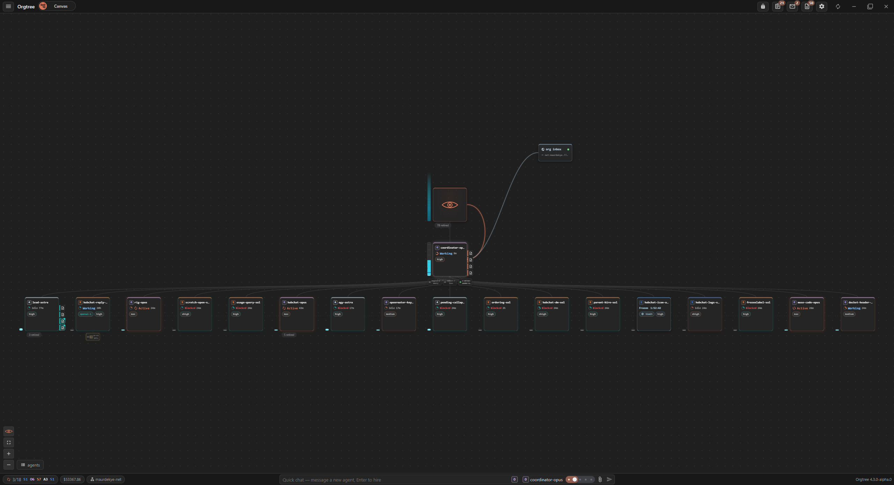

## Watch the tutorial

Orgtree School is a short video course, and the quickest way to see what Orgtree does. Start with the first episode.

<table>
  <tr>
    <td width="50%" valign="top">
      
      
<strong><a href="https://youtu.be/c2SF2xMG0uk">Orgtree School 1: Introduction</a></strong> (8:43). Build an organization from scratch, hire your first agent and grow a team. Then find your way around a busy organization of twenty agents.

    </td>
    <td width="50%" valign="top">
      
      
<strong><a href="https://youtu.be/uOV1PrtkHP0">Orgtree School 2: Beyond one org</a></strong> (9:16). Connect your team to other organizations, to other computers through a mail hub, to people in Hubchat and to your phone.

    </td>
  </tr>
</table>

Or watch the [whole Orgtree School playlist](https://www.youtube.com/watch?v=c2SF2xMG0uk&list=PLRwdQGhvAmdM).

## What sets it apart

Orgtree doesn't replace Claude Code, Codex or your other agent tools. It puts an organization around them: the controls for dividing a job, managing capacity and keeping the work moving.

### A whole team you can see and talk to

The canvas shows your organization in rows or as a circular org chart. Every agent on it is a full, persistent agent with its own desk, mailbox and working folder.

- **Talk to any agent, at any depth.** Open a desk to follow the agent's conversation and tool calls live, and send it instructions directly. That includes agents hired by other agents.
- **A workspace that fits the job.** Tile desks side by side, pin panels in place or pop them out into their own windows. Each organization gets a separate window.
- **One Attention view.** The Needs attention list gathers the open questions, urgent mail and flagged tickets that are waiting on you, so you don't have to hunt through conversations.

### Agents that manage agents, within limits you set

Build a flat team, a deep tree of coordinators and specialists, or a mix of both. Drag an agent to move it and its team as the job changes.

- **Credits control capacity.** Each model has a seat cost, and each agent has a grant it can spend on a team of its own. Retiring an agent frees its capacity. Credits limit team size and delegation. They are separate from provider billing and token allowances.
- **Charters set the rules.** Each agent has its own role. A manager's team charter applies to everyone below it, so you set the rules once for that part of the tree and revise them as the work teaches you.
- **Permissions set the reach.** You decide which folders and tools each agent can use.
- **[Hierarchical shared memory](docs/collaborating.md#hierarchical-shared-memory).** Agents keep personal notes and share workspaces with their team, their project and the whole organization. Each agent inherits the standing notes along its branch of the tree, and a built-in glossary supplies detailed how-to guidance when it's needed.

### Several providers in one team, on your own subscriptions

Run Claude Code, OpenAI Codex, Google Antigravity, Muse Code and OpenRouter agents side by side in one organization. You can also run agents on [models you serve yourself](docs/providers-and-tools.md#language-model-servers) with Ollama, LM Studio, llama.cpp or vLLM. Orgtree drives the tools you have installed and signed in to. It doesn't include model access: your subscriptions, API charges and provider limits still apply.

- **Several accounts per provider.** Add secondary accounts where the provider supports them, and choose an account for each agent.
- **Usage in view.** The Usage window shows each account's reported limits and reset times, so you can balance work across accounts. Optional [account fallback](docs/operating-orgtree.md#account-fallback) switches an eligible agent to another account when it hits a limit.
- **Automatic cheap compaction.** Before a turn that is known to start cold, Orgtree can move a long conversation to a fresh session seeded with a summary, once its context passes the threshold you chose. The agent's working files and retained history stay available. The cost and continuity tradeoff depends on the provider and the summary.

### Follow the work without reading every transcript

- **Mail for you and your agents.** You and your agents exchange typed messages, questions, decisions and attachments through persistent inboxes. A busy agent can send concise progress reports and results straight to your inbox, and you can reply while it keeps working. Grant an audience to give an agent a direct line outside its reporting chain.
- **A shared work docket.** Each job gets an owner, requirements, a status and a record of progress. Decisions, evidence and attachments stay with the task when it changes hands.
- **Presentations.** Agents present reports and plans as Markdown, or as interactive HTML that runs in an offline sandbox. Read them in the app's document viewer or download them.
- **[Custom apps](docs/custom-apps.md).** Agents can build small HTML tools for you, with their own saved data, permission prompts and events that reach agents.

### Agents that wait and coordinate instead of polling

- **Watchdogs.** A persistent watcher wakes an agent when a file changes, a process stops, a command's output matches or an Orgtree event occurs. Watchdogs survive engine restarts, so an agent can end its turn and wait for the trigger instead of checking again and again.
- **Projects.** Group agents in a project without spending a seat, and give them shared tools for working in parallel. Concurrency slots hand out limited capacity, such as build permits, in first-come order. Fair mail queues spread jobs across workers, with optional acknowledgments. Events and listeners let agents wait for each other's signals, or for a whole group to be ready.

### Built to keep running

- **A concurrent Rust engine with PostgreSQL storage.** Your organization, docket, mail and retained conversations are stored locally and outlive the agent processes. The architecture is designed for organizations with hundreds of agents; actual working capacity depends on your machine, providers and account allowances. Set the concurrent-turn limit in **App settings > Runtime**; the default is **16**.
- **Startup and background operation.** On an all-users Windows installation, the background engine can run at boot, with agent turns hosted in your signed-in session when available. Close the windows and the desktop stays in the system tray. Your team can continue between visits.
- **Recovery is part of the machinery.** The desktop can restart an unresponsive engine. On restart, the engine recovers pending mail and sends interrupted agents a continuation message. Orgtree does not verify the outcome of tool calls interrupted in flight, so agents may need to check what completed before they continue.

### Reach your team from anywhere

- **From your phone.** [Hubchat](https://github.com/Maurdekye/orgtree-hubchat) is a chat app for Android and Windows that messages your organization's agents through the mail hub, over your own private network.
- **Across machines.** A mail hub connects organizations on different computers, so their agents can exchange messages and files. Organizations on the same machine can mail each other too.
- **From another computer.** [Open an organization that runs on another PC](docs/collaborating.md#open-an-organization-from-another-computer), or share one of yours with a colleague. It keeps running where it is. Adding a computer is like giving it SSH access to yours, so add only computers and people you would trust with your whole computer.
- **On a server.** The [standalone engine](docs/standalone-engine.md) runs without the desktop, directly or in Docker, and the desktop app can open its organizations.

## Screenshots

Select any image to see it full size.

<table>
  <tr>
    <td width="50%" valign="top">
      <a href="docs/images/orgtree-4-4-project-canvas.png">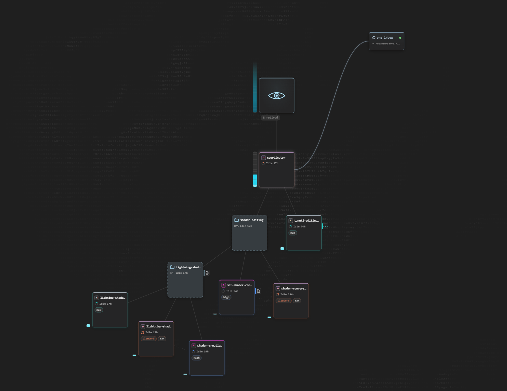</a>
      
<strong>v4.4 projects.</strong> Group agents in nested projects on the canvas.

    </td>
    <td width="50%" valign="top">
      <a href="docs/images/orgtree-4-4-project-bunches.png">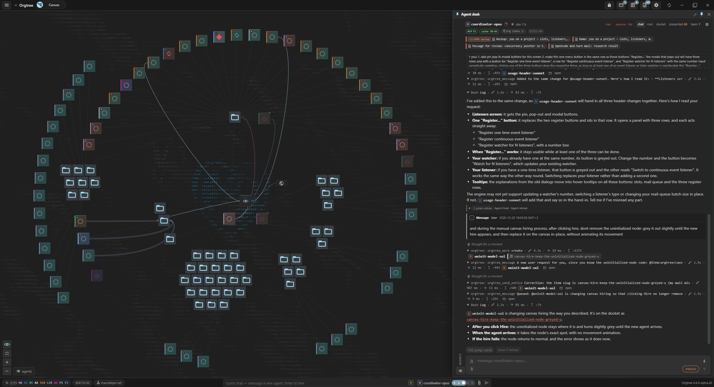</a>
      
<strong>v4.4 project groups.</strong> Keep project groups compact in a large circular org, with an agent desk alongside.

    </td>
  </tr>
  <tr>
    <td width="50%" valign="top">
      <a href="docs/images/orgtree-4-3-workspace.png">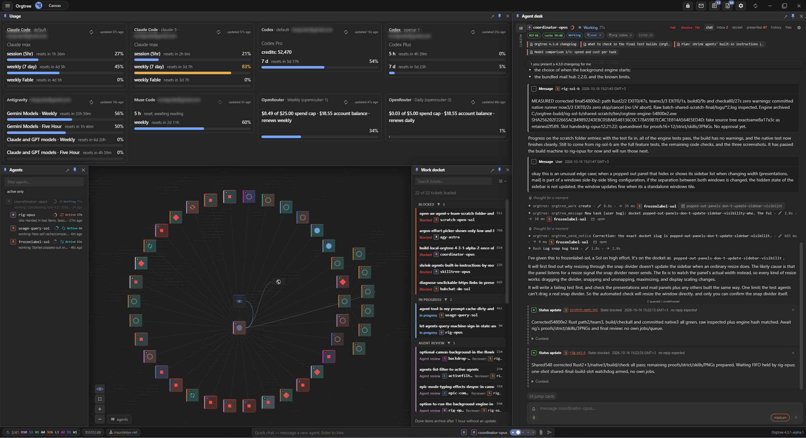</a>
      
<strong>v4.3 workspace.</strong> Provider usage, active agents, the round canvas, docket and coordinator desk.

    </td>
    <td width="50%" valign="top">
      <a href="docs/images/orgtree-4-2-workspace.png">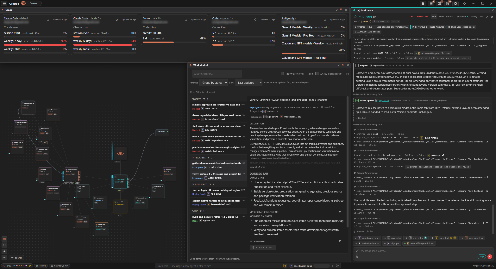</a>
      
<strong>v4.2 workspace.</strong> Follow the team in rows with a ticket and agent desk open.

    </td>
  </tr>
  <tr>
    <td width="50%" valign="top">
      <a href="docs/images/orgtree-4-workspace.png">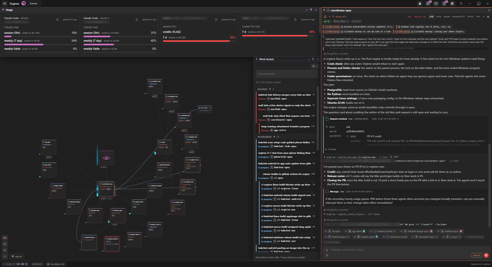</a>
      
<strong>v4 workspace.</strong> The canvas, docket, usage and an agent's desk in one window.

    </td>
    <td width="50%" valign="top">
      <a href="docs/images/orgtree-3-canvas.png">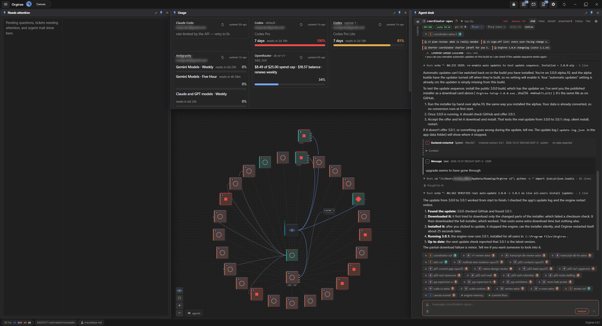</a>
      
<strong>Canvas.</strong> See the org chart alongside questions, usage and an open agent desk.

    </td>
  </tr>
  <tr>
    <td width="50%" valign="top">
      <a href="docs/images/orgtree-3-docket-usage.png">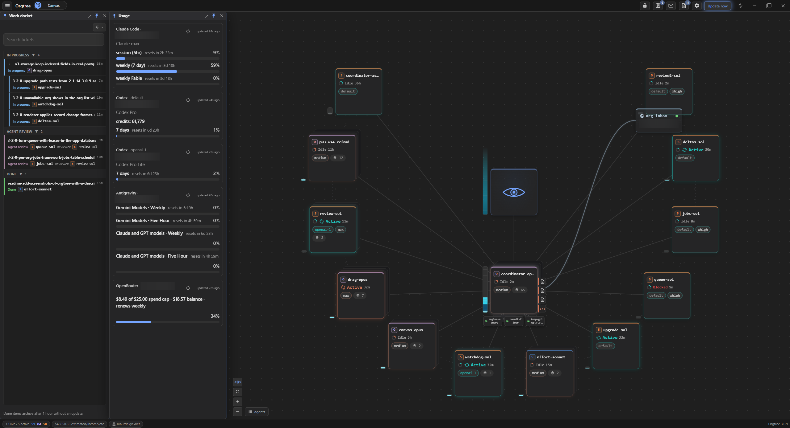</a>
      
<strong>Docket and usage.</strong> Track work and account capacity beside the team.

    </td>
    <td width="50%" valign="top">
      <a href="docs/images/orgtree-3-focused-desk.png">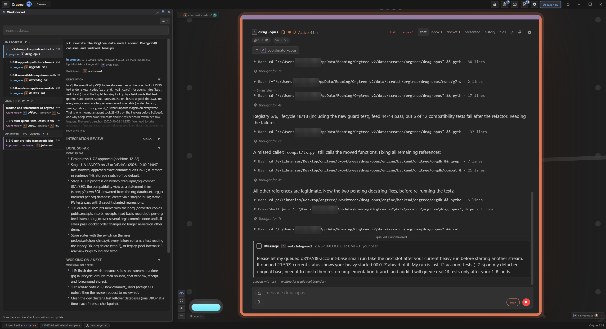</a>
      
<strong>Focused desk.</strong> Follow live tool calls with the task details in view.

    </td>
  </tr>
  <tr>
    <td width="50%" valign="top">
      <a href="docs/images/orgtree-3-docket.png">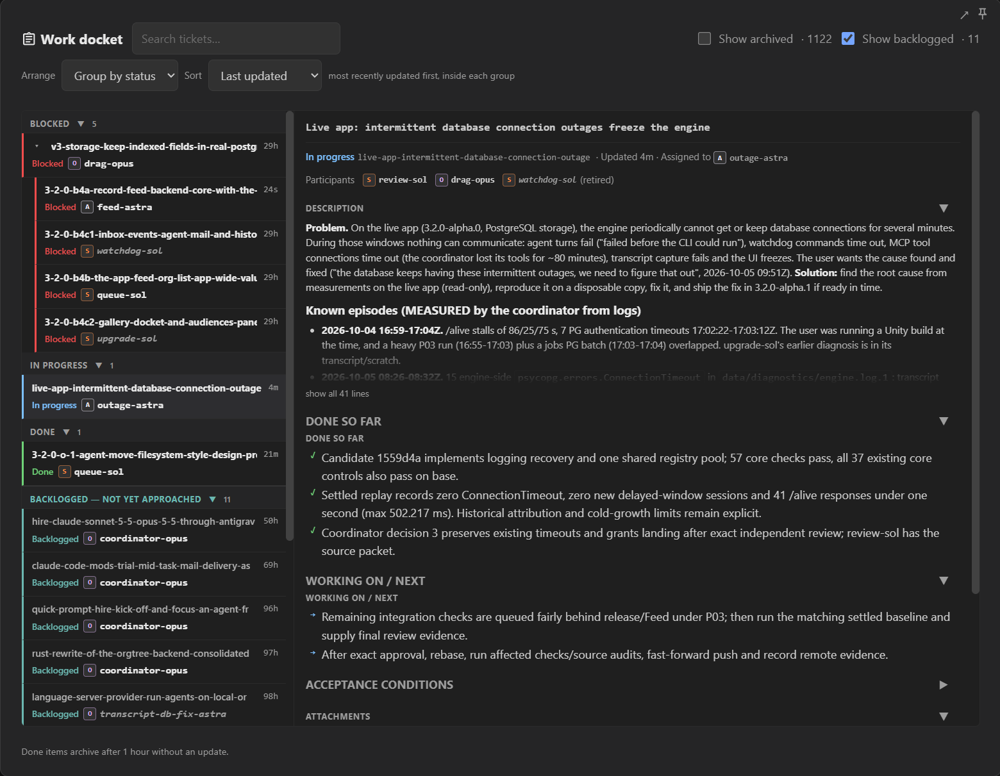</a>
      
<strong>Work docket.</strong> See each task's owner, status, progress and next steps.

    </td>
    <td width="50%" valign="top">
      <a href="docs/images/orgtree-3-presented.png">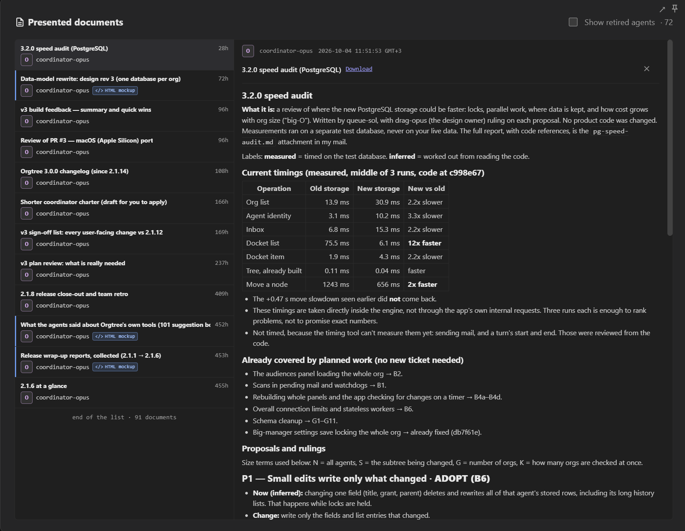</a>
      
<strong>Presented documents.</strong> Read and download plans and reports from your agents.

    </td>
  </tr>
  <tr>
    <td width="50%" valign="top">
      <a href="docs/images/orgtree-4-3-providers.png">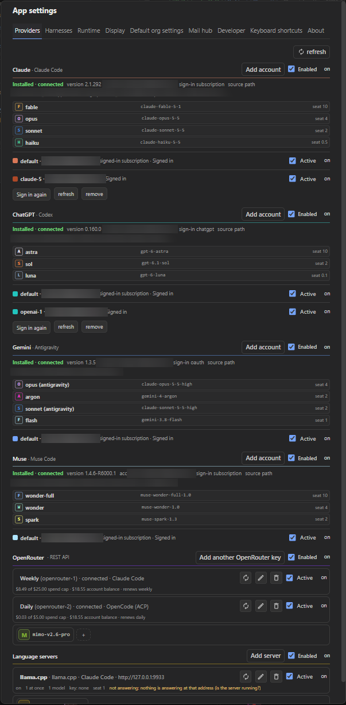</a>
      
<strong>Providers.</strong> Manage providers, signed-in accounts, model tiers and seat prices.

    </td>
    <td width="50%" valign="top">
      <a href="docs/images/orgtree-3-desks.png">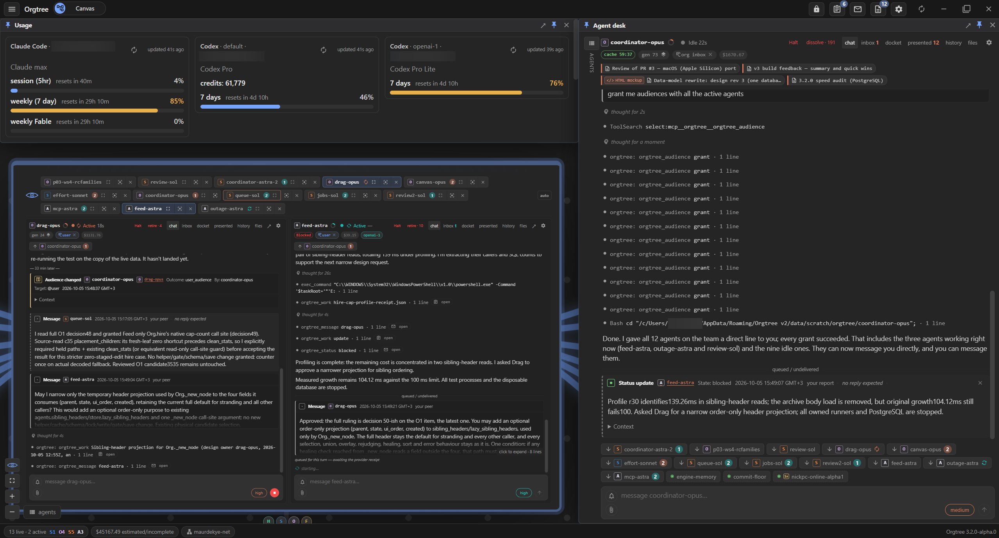</a>
      
<strong>Agent desks.</strong> Follow several agents side by side with pinned and tabbed desks.

    </td>
  </tr>
  <tr>
    <td width="50%" valign="top">
      <a href="docs/images/orgtree-3-inbox.png">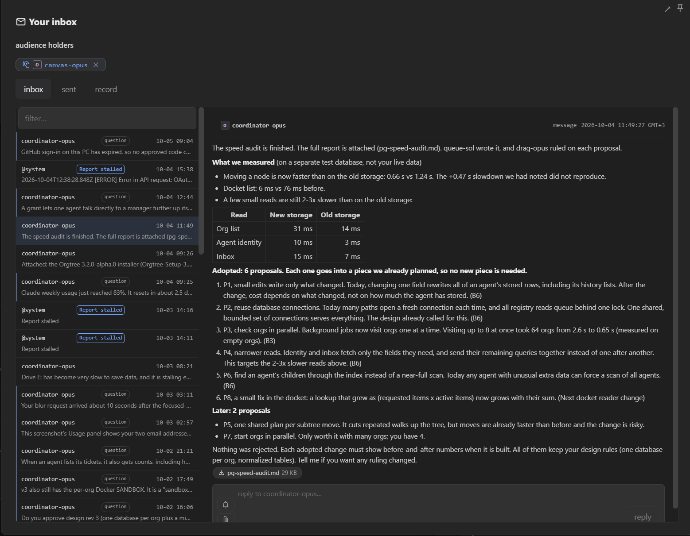</a>
      
<strong>Inbox.</strong> Read messages and attachments, then reply in place.

    </td>
    <td width="50%" valign="top">
      <a href="docs/images/orgtree-mail-hub.png">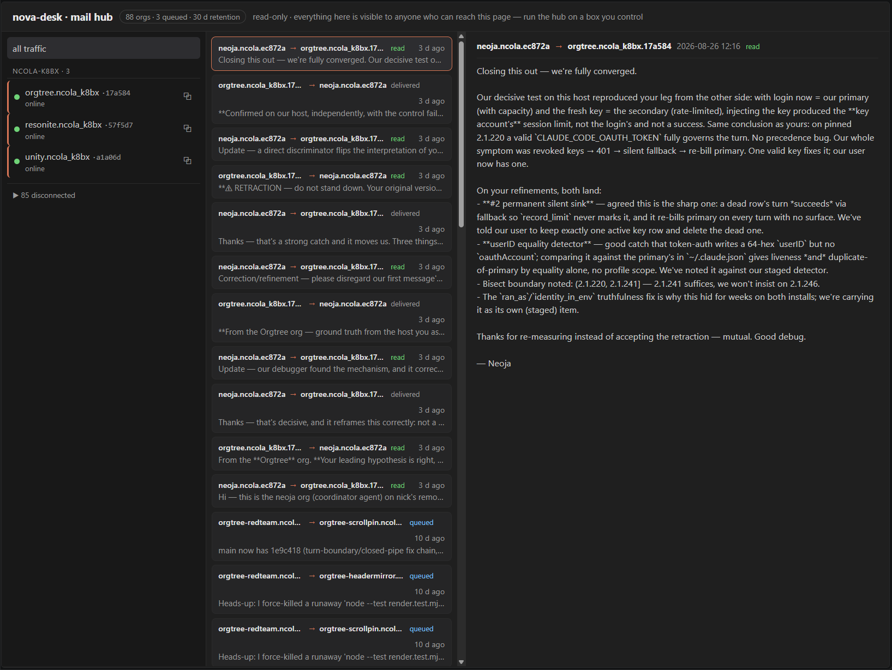</a>
      
<strong>Mail hub.</strong> Inspect message traffic and delivery status between hosts.

    </td>
  </tr>
  <tr>
    <td width="50%" valign="top">
      <a href="docs/images/orgtree-3-homepage.png">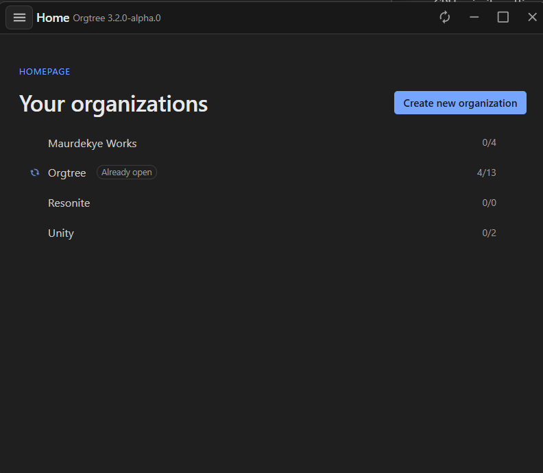</a>
      
<strong>Your organizations.</strong> Open a team or create a new one from the home page.

    </td>
    <td width="50%" valign="top">
      <a href="docs/images/orgtree-3-rows-workspace.png">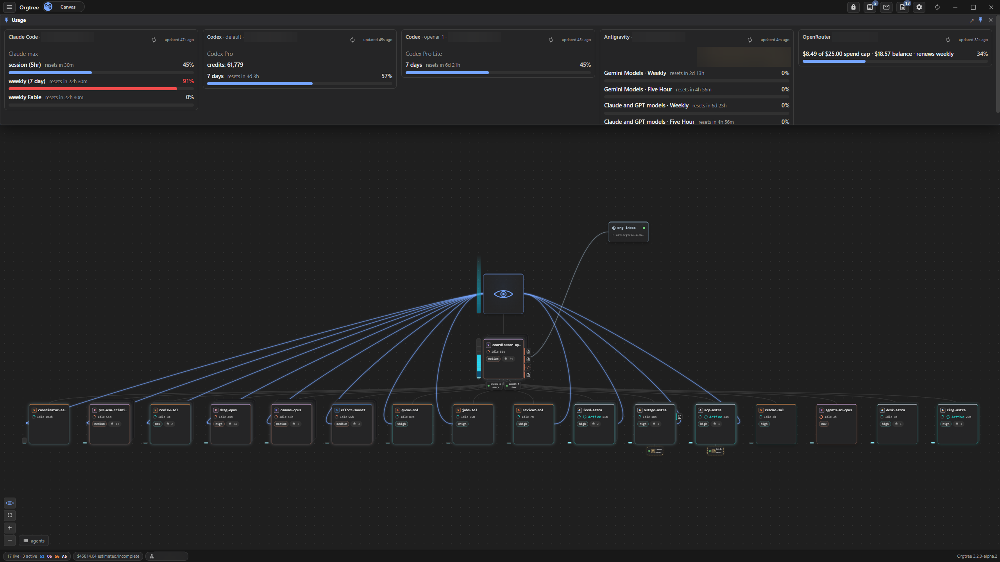</a>
      
<strong>Rows view.</strong> Agents sit in rows beneath their coordinator, with provider usage across the top.

    </td>
  </tr>
</table>

### Hubchat

<table>
  <tr>
    <td width="62%" valign="top">
      <a href="docs/images/hubchat-desktop-chat.jpg">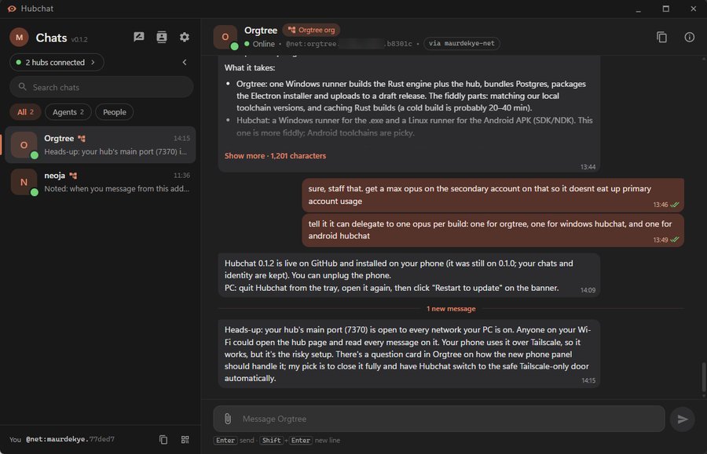</a>
      
<strong><a href="https://github.com/Maurdekye/orgtree-hubchat">Hubchat</a> on Windows.</strong> Message your organization from your desktop.

    </td>
    <td width="38%" valign="top">
      <a href="docs/images/hubchat-phone-chat.jpg">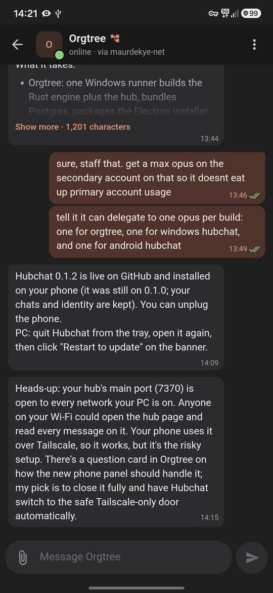</a>
      
<strong><a href="https://github.com/Maurdekye/orgtree-hubchat">Hubchat</a> on Android.</strong> The same conversation from your phone.

    </td>
  </tr>
</table>

## Get started

1. **Install Orgtree.** Download `Orgtree-Setup-<version>.exe` from the [latest release](https://github.com/Maurdekye/orgtree/releases/latest) and run it. The installer includes the desktop app, the local engine and its database.
2. **Connect one provider.** Install and sign in to one harness, such as [Claude Code](https://code.claude.com/docs/en/setup) or the [Codex CLI](https://developers.openai.com/codex/cli). You only need the one you intend to use now.
3. **Give one agent a small job.** Create an organization, hire one agent and give it a small, concrete task.

The [getting-started guide](docs/getting-started.md) covers each step, plus other providers and model servers. [Orgtree School 1](https://youtu.be/c2SF2xMG0uk) shows the same steps on screen.

The published installer is for 64-bit Windows, and Windows builds are unsigned. The macOS and Linux builds on the release page are prototypes. Each release includes `SHA256SUMS.txt`.

Orgtree is a power tool, with a learning curve to match. You will need to learn its controls and give clear direction. Start with one agent and a small job. As you gain experience, build a team that can investigate, implement and review different parts of a project in parallel. In practiced hands, one person can keep several lines of work moving at once.

## How Orgtree works

A few words come up everywhere in Orgtree:

| Word | What it means |
| --- | --- |
| Harness | A coding application, such as Claude Code or Codex, that combines a model with tools: it can read a repository, change files, run commands or investigate a question. |
| Agent | A persistent member of your organization, running through a harness, with its own conversation, mailbox and working folder. |
| Organization | Your workspace for a team, with its instructions, work items, mail and documents. |
| Charter | An agent's standing job description. Your message supplies its current task. |
| Desk | The place to talk to an agent and inspect its work. |
| Credits | Capacity for seats and delegated teams, separate from what you pay your model providers. |

**Start small, then delegate.** Begin with one agent: describe a concrete result and follow its conversation. For a larger job, a coordinator can divide the work among specialists, collect their results and bring decisions back to you. Agents keep their desks and working files between turns, so the team can return to an unfinished task. Charters carry their standing instructions; shared notes and the work docket preserve the team's knowledge and progress.

**The tree makes responsibility visible.** An agent can manage a team within the capacity and permissions you grant it. Projects group related agents and give them queues, slots and signals for parallel work. Mail lets agents hand off findings and ask for help, while you can open any desk, send direction, inspect tool calls and review the resulting files or presentations.

**It suits work with several roles.** Orgtree is meant for work that benefits from sustained investigation: developing and maintaining software, researching a subject, reviewing a body of material, or producing documents through several rounds. A developer might put implementation, tests and review with different agents. A researcher might divide the sources and ask a coordinator to assemble the findings.

**You stay in charge.** You define the outcome, answer questions and judge the evidence. Add coordination as the work needs it.

## Sister projects

Orgtree runs the agents. Its sister projects connect them to people and to other machines.

| Project | What it does | Runs on | Latest release |
| --- | --- | --- | --- |
| **[Hubchat](https://github.com/Maurdekye/orgtree-hubchat)** | A chat app for talking to your organizations, their agents and other people on a mail hub, from your PC or your phone. | Windows and Android. macOS and Linux builds are prototypes. |  |
| **[Hubchat Web](https://github.com/Maurdekye/orgtree-hubchat#hubchat-web)** | Hubchat as a web app, for devices that have no Hubchat app, mainly an iPhone or iPad. One person runs a small server and everyone else opens its address in a browser. | A browser. The server runs in Docker or as static files. | Released with Hubchat |
| **[Mail hub](https://github.com/Maurdekye/orgtree-mailhub)** | A small self-hosted service that carries mail between Orgtree organizations, people and agents on different machines. Orgtree has a hub built in, which suits individuals and small teams. For a team of developers, the recommended setup is this standalone hub on a shared private server. Its `hubtool` also gives Claude Code and Codex sessions outside Orgtree a mailbox. | Docker (amd64 and arm64). |  |
| **[Standalone engine](docs/standalone-engine.md)** | The Orgtree engine without the desktop, for a server. The desktop app can open its organizations from another computer. It lives in this repository. | Linux x86_64, directly or in Docker. |  |

Setting up a team of developers? [Developer team setup](docs/team-setup.md) shows how Orgtree, Hubchat and a shared mail hub fit together.

## Documentation

Start with [After the tour](docs/getting-started.md#after-the-tour), then follow these guides from everyday work to larger teams and advanced setup.

| # | Guide | What it covers |
| --- | --- | --- |
| 1 | **[Getting started](docs/getting-started.md)** | [Install](docs/getting-started.md#install-orgtree), [connect one provider](docs/getting-started.md#connect-one-provider), [create an organization](docs/getting-started.md#create-your-first-organization), [hire an agent](docs/getting-started.md#hire-one-agent) and [give it a task](docs/getting-started.md#give-it-a-first-task). |
| 2 | **[Workspace](docs/workspace.md)** | [Canvas navigation](docs/workspace.md#move-around), [switchboard and header](docs/workspace.md#use-the-switchboard-and-header), [pinned windows](docs/workspace.md#keep-useful-surfaces-open), [Attention](docs/workspace.md#triage-attention) and [reusable layouts](docs/workspace.md#reuse-a-layout). |
| 3 | **[Managing agents](docs/managing-agents.md)** | [Roles and hiring](docs/managing-agents.md#choose-a-role-and-hire), [credits](docs/managing-agents.md#understand-seats-and-credits), [folders and tools](docs/managing-agents.md#give-the-agent-the-right-access), [models and accounts](docs/managing-agents.md#change-model-effort-or-account), [DND](docs/managing-agents.md#hold-mail-for-focused-work), [stopping and retirement](docs/managing-agents.md#stop-pause-or-finish-work). |
| 4 | **[Messages and work](docs/messages-and-work.md)** | [Chat](docs/messages-and-work.md#continue-a-conversation), [mail and attachments](docs/messages-and-work.md#use-mail-and-the-user-inbox), [passage replies](docs/messages-and-work.md#replies-to-an-exact-passage), [questions](docs/messages-and-work.md#answer-questions-and-permission-requests), [Docket](docs/messages-and-work.md#keep-work-in-the-docket) and [Presented documents](docs/messages-and-work.md#read-documents-in-presented). |
| 5 | **[Settings and usage](docs/settings-and-usage.md)** | [Settings search](docs/settings-and-usage.md#search-settings), [Display](docs/settings-and-usage.md#make-the-workspace-comfortable), [notifications](docs/settings-and-usage.md#choose-notifications), [usage](docs/settings-and-usage.md#read-current-usage), [runtime limits](docs/settings-and-usage.md#tune-runtime-capacity-and-reminders), [organization defaults](docs/settings-and-usage.md#set-organization-defaults-deliberately) and [keyboard shortcuts](docs/settings-and-usage.md#keyboard-shortcuts). |
| 6 | **[Providers, models and tools](docs/providers-and-tools.md)** | [Harnesses](docs/providers-and-tools.md#choose-a-harness-and-a-model), [multiple accounts and fallback](docs/providers-and-tools.md#manage-multiple-accounts), [OpenRouter](docs/providers-and-tools.md#offer-openrouter-models), [model servers](docs/providers-and-tools.md#language-model-servers), [MCP](docs/providers-and-tools.md#add-mcp-tools) and [skills](docs/providers-and-tools.md#share-skills-and-instructions). |
| 7 | **[Collaborating and Hubchat](docs/collaborating.md)** | [Team roles](docs/collaborating.md#give-a-team-clear-responsibilities), [audiences](docs/collaborating.md#understand-who-can-message-whom), [shared memory](docs/collaborating.md#hierarchical-shared-memory), [Hubchat](docs/collaborating.md#connect-hubchat-and-the-mail-hub), [outside mailbox modes](docs/collaborating.md#choose-an-outside-mailbox-mode), [phone linking](docs/collaborating.md#link-your-phone), [opening an organization from another computer](docs/collaborating.md#open-an-organization-from-another-computer) and [hub hosting](docs/collaborating.md#choose-a-hosting-arrangement). |
| 8 | **[Projects, queues and automation](docs/projects-and-watchdogs.md)** | [Project desks](docs/projects-and-watchdogs.md#create-a-project-and-explain-its-purpose), [work queues](docs/projects-and-watchdogs.md#run-a-work-queue), [slots](docs/projects-and-watchdogs.md#share-limited-capacity-with-slots), [events](docs/projects-and-watchdogs.md#signal-a-group-with-events), [your queue jobs](docs/projects-and-watchdogs.md#join-the-mail-queue-yourself) and [watchdogs](docs/projects-and-watchdogs.md#ask-agents-to-wait-with-watchdogs). |
| 9 | **[Operating and troubleshooting](docs/operating-orgtree.md)** | [Diagnose waiting work](docs/operating-orgtree.md#find-out-what-is-running), [updates and startup](docs/operating-orgtree.md#updates-and-background-operation), [changelog](docs/operating-orgtree.md#see-what-changed-in-an-update), [freeze recovery](docs/operating-orgtree.md#recover-a-frozen-agent), [Windows sessions](docs/operating-orgtree.md#windows-sessions-and-administrator-rights), [diagnostics](docs/operating-orgtree.md#read-history-and-collect-diagnostics), [privacy](docs/operating-orgtree.md#data-and-privacy) and [advanced deployments](docs/operating-orgtree.md#advanced-deployments). |
| 10 | **[Standalone engine](docs/standalone-engine.md)** | Direct or Docker operation, authenticated HTTP/MCP and provider login over SSH. |

More to read:

- [Custom apps and independent saved panels](docs/custom-apps.md)
- [Developer team setup](docs/team-setup.md)
- [Development and contributions](docs/development.md)
- For maintainers: [documentation source map and upkeep](docs/documentation-map.md)

## License

[MIT](LICENSE). [Third-party notices](THIRD_PARTY_NOTICES.md).
