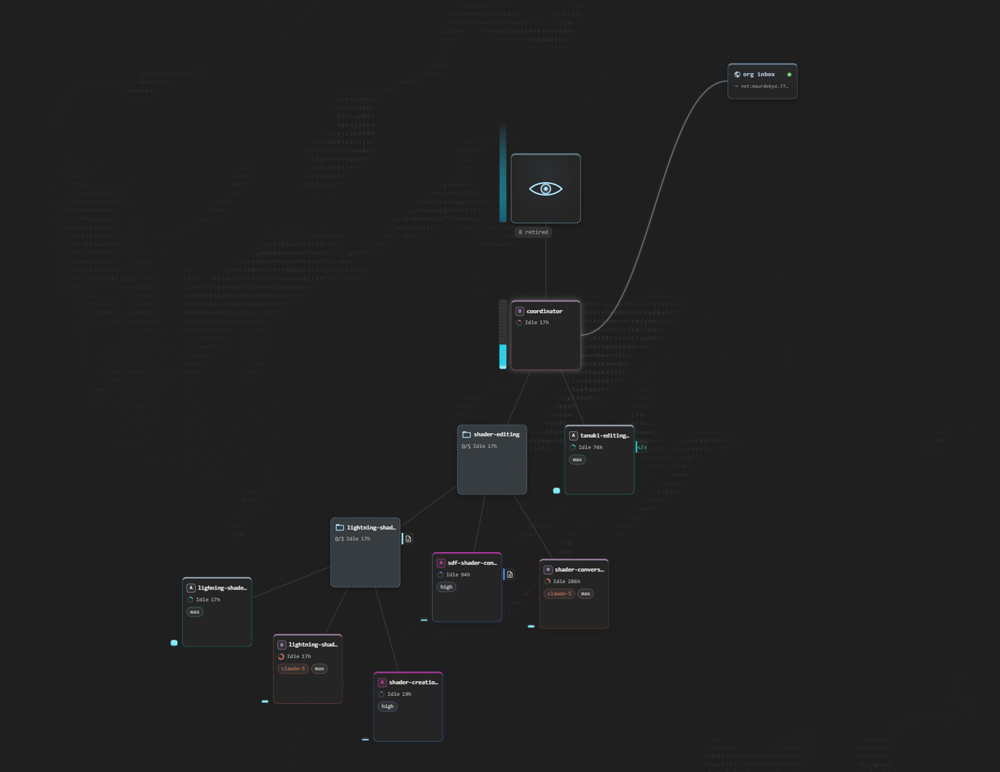
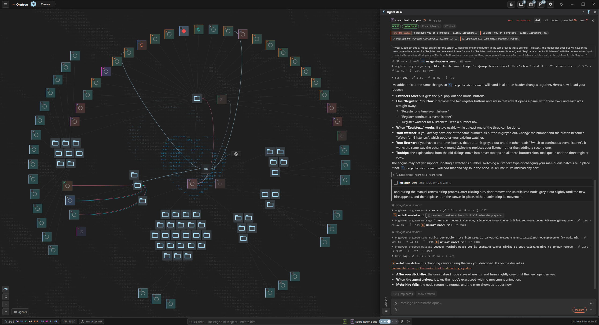

# Orgtree

**Put a team of AI agents to work. Keep control of the job.**

Companion apps: **[Hubchat](https://github.com/Maurdekye/orgtree-hubchat)**, a chat app for talking to your orgs and agents from your PC or phone, and the **[mail hub](https://github.com/Maurdekye/orgtree-mailhub)**, a small self-hosted service that lets Orgtree organizations, people and agents on different machines mail each other.

Orgtree is a desktop power tool for running persistent teams of AI agents. Give them a project, divide the work, and follow it through to delivery. Assign roles, set limits, inspect the work and keep the decisions in one place.

It is a substantial tool, with a learning curve to match. You will need to learn its controls and give clear direction. Start with one agent and a small job. As you gain experience, build a team that can investigate, implement and review different parts of a project in parallel. In practiced hands, one person can keep several lines of work moving at once.

**[Download the latest Windows installer](https://github.com/Maurdekye/orgtree/releases/latest)** | [Release notes](https://github.com/Maurdekye/orgtree/releases) | [Report an issue](https://github.com/Maurdekye/orgtree/issues)

## What sets it apart

Orgtree puts the controls for a whole organization around your agent harnesses. These are the tools for dividing the job, managing capacity and keeping the work moving.

- **A canvas you can rearrange.** View the team in rows or as a circular org chart, then drag agents to rearrange it. Open any agent's desk to inspect its live conversation and tool calls.
- **Talk to any agent, at any depth.** Every agent in the tree is a full, persistent agent with its own desk. Open it and send instructions or follow-up messages directly, including to agents hired by other agents.
- **A hierarchy you choose.** Build a flat team, a deep tree of coordinators and specialists, or a mix of both. Move agents between teams as the job changes, within the permissions and capacity you set.
- **Team charters.** Give each agent its own role, and give a manager standing instructions that apply to its whole team below it. Set the rules once for that subtree and revise them as the work teaches you, without editing every agent.
- **[Hierarchical shared memory](docs/collaborating.md#hierarchical-shared-memory).** Give agents persistent personal notes and shared workspaces for their teams, projects and whole organization. Each agent inherits the standing notes along its branch of the tree; the built-in glossary supplies detailed how-to guidance when needed.
- **A shared work docket and tickets.** Give each job an owner, requirements, status and a record of progress. Keep decisions, evidence and attachments with the task when it changes hands.
- **Credits that control capacity.** Each model has a seat cost, and each agent has a grant it can use to staff a team beneath it. Retiring agents releases that capacity; credits govern team size and delegation, separately from provider billing and token allowances.
- **Mail for you and your agents.** Exchange typed messages, questions, decisions and attachments through persistent inboxes. A busy agent can send concise progress reports and results straight to your inbox, so you can follow the work without scrolling through hours of tool calls. Reply while it keeps working, or grant an audience for a direct line outside its reporting chain.
- **A mail hub across machines.** Connect organizations on different computers through a shared hub and let their agents exchange messages and files. Local organizations can communicate on the same machine, too.
- **Chat from your phone.** [Hubchat](https://github.com/Maurdekye/orgtree-hubchat) is a companion app for Android and Windows that messages your organization's agents through the mail hub, over your own private network.
- **Watchdogs that wait for the right event.** Persistent watchers can wake an agent when a file changes, a process stops, command output matches or an Orgtree event occurs. They survive engine restarts, so agents can wait for a trigger instead of repeatedly checking for it.
- **Projects for coordinating concurrent work.** Group agents in a project without spending a seat, and give them shared tools for working in parallel. Concurrency slots hand out limited capacity, such as build permits, in first-come order; fair mail queues spread jobs across workers with optional acknowledgments; events and listeners let agents wait for each other's signals or for a group to be ready.
- **Automatic cheap compaction.** Enable a reset before a known-cold turn when context exceeds your chosen threshold. The agent starts a fresh session seeded with a summary while its working files and retained history remain available. The cost and continuity tradeoff depends on the provider and the summary.
- **A concurrent Rust engine with PostgreSQL storage.** Independent agent tasks, short database transactions and paged reads are designed to keep large teams responsive. Your organization, docket, mail and retained conversations are stored locally and outlive the agent processes.
- **Startup and background operation.** Run the background engine at boot on an all-users Windows installation, with agent turns hosted in your signed-in session when available. Keep the desktop in the system tray when you close its windows. Your team can continue between visits.
- **Window management for a working desk.** Tile desks side by side, pin panels in place or pop them out into separate windows. Keep the task, conversation and account usage in view together, with a separate window for each organization.
- **Markdown and HTML presentations.** Agents can present readable reports, plans and HTML mockups inside the app. Open them in the document viewer or download them for use elsewhere.
- **One Attention view.** The Needs attention list gathers open questions, urgent mail and flagged tickets waiting on you. Handle them in one place without hunting through agents' conversations.
- **Multiple providers and accounts.** Run Claude Code, OpenAI Codex, Google Antigravity, Muse Code and OpenRouter agents in the same organization, with supported secondary accounts and per-agent account selection. Use reported limits and reset times on the Usage board to balance work across accounts, with optional [account fallback](docs/operating-orgtree.md#account-fallback) when an eligible agent hits a limit.

The architecture is designed for organizations with hundreds of agents; actual working capacity depends on your machine, providers and account allowances. Set the concurrent-turn limit in **App settings > Runtime**; the default is **16**.

Recovery is part of the machinery. The desktop can restart an unresponsive engine. On restart, the engine recovers pending mail and sends interrupted agents a continuation message. Orgtree does not verify the outcome of tool calls interrupted in flight; agents may need to check what completed before continuing.

## Screenshots

Select any image to see it full size.

<table>
  <tr>
    <td width="50%" valign="top">
      
      
<strong>v4.4 projects.</strong> Group agents in nested projects on the canvas.

    </td>
    <td width="50%" valign="top">
      
      
<strong>v4.4 project groups.</strong> Keep project groups compact in a large circular org, with an agent desk alongside.

    </td>
  </tr>
  <tr>
    <td width="50%" valign="top">
      
      
<strong>v4.3 workspace.</strong> Provider usage, active agents, the round canvas, docket and coordinator desk.

    </td>
    <td width="50%" valign="top">
      
      
<strong>v4.2 workspace.</strong> Follow the team in rows with a ticket and agent desk open.

    </td>
  </tr>
  <tr>
    <td width="50%" valign="top">
      
      
<strong>v4 workspace.</strong> The canvas, docket, usage and an agent's desk in one window.

    </td>
    <td width="50%" valign="top">
      
      
<strong>Canvas.</strong> See the org chart alongside questions, usage and an open agent desk.

    </td>
  </tr>
  <tr>
    <td width="50%" valign="top">
      
      
<strong>Docket and usage.</strong> Track work and account capacity beside the team.

    </td>
    <td width="50%" valign="top">
      
      
<strong>Focused desk.</strong> Follow live tool calls with the task details in view.

    </td>
  </tr>
  <tr>
    <td width="50%" valign="top">
      
      
<strong>Work docket.</strong> See each task's owner, status, progress and next steps.

    </td>
    <td width="50%" valign="top">
      
      
<strong>Presented documents.</strong> Read and download plans and reports from your agents.

    </td>
  </tr>
  <tr>
    <td width="50%" valign="top">
      
      
<strong>Providers.</strong> Manage providers, signed-in accounts, model tiers and seat prices.

    </td>
    <td width="50%" valign="top">
      
      
<strong>Agent desks.</strong> Follow several agents side by side with pinned and tabbed desks.

    </td>
  </tr>
  <tr>
    <td width="50%" valign="top">
      
      
<strong>Inbox.</strong> Read messages and attachments, then reply in place.

    </td>
    <td width="50%" valign="top">
      
      
<strong>Mail hub.</strong> Inspect message traffic and delivery status between hosts.

    </td>
  </tr>
  <tr>
    <td width="50%" valign="top">
      
      
<strong>Your organizations.</strong> Open a team or create a new one from the home page.

    </td>
    <td width="50%" valign="top">
      
      
<strong>Rows view.</strong> Agents sit in rows beneath their coordinator, with provider usage across the top.

    </td>
  </tr>
</table>

### Hubchat

<table>
  <tr>
    <td width="62%" valign="top">
      
      
<strong><a href="https://github.com/Maurdekye/orgtree-hubchat">Hubchat</a> on Windows.</strong> Message your organization from your desktop.

    </td>
    <td width="38%" valign="top">
      
      
<strong><a href="https://github.com/Maurdekye/orgtree-hubchat">Hubchat</a> on Android.</strong> The same conversation from your phone.

    </td>
  </tr>
</table>

## Get started

[Download the latest Windows installer](https://github.com/Maurdekye/orgtree/releases/latest), then set up a supported provider.
Create an organization, hire one agent and give it a small, concrete task.
The [getting-started guide](docs/getting-started.md) covers installation, providers, model servers and your first organization.

## How Orgtree works

A harness combines a language model with tools that can act on a task: read a repository, change files, run commands or investigate a question. Orgtree runs these harnesses, such as Claude Code and Codex, as agents: persistent members of your organization, each with its own conversation, mailbox and working folder. You choose the models and accounts, give each agent a role, and decide which folders and tools it can use.

An organization is the workspace around those agents. Start with one agent, describe a concrete result and follow its conversation. For a larger job, a coordinator can divide the work among specialists, collect their results and bring decisions back to you. Agents keep their desks and working files between turns, so the team can return to an unfinished task. Their charters carry standing instructions; shared notes and the work docket preserve the team's knowledge and progress.

The tree makes responsibility visible. An agent can manage a team within the capacity and permissions you grant it. Projects group related agents and provide queues, slots and signals for coordinating parallel work. Mail lets agents hand off findings and ask for help, while you can open any desk, send direction, inspect tool calls and review the resulting files or presentations. Credits limit staffing capacity; provider subscriptions and API charges pay for model use separately.

This is meant for work that benefits from sustained investigation and several roles: developing and maintaining software, researching a subject, reviewing a body of material, or producing documents through several rounds of work. A developer might put implementation, tests and review with different agents; a researcher might divide sources and ask a coordinator to assemble the findings. Individuals and teams can use it, with Hubchat and a shared mail hub connecting people and organizations across machines.

Orgtree is a power tool for people willing to direct and check that work. You still define the outcome, answer questions and judge the evidence. Begin with a small task and add coordination as the work needs it.

## Documentation

Start with [After the tour](docs/getting-started.md#after-the-tour), then follow these guides from everyday work to larger teams and advanced setup.

1. [Getting started](docs/getting-started.md) — [Install](docs/getting-started.md#install-orgtree), [connect one provider](docs/getting-started.md#connect-one-provider), [create an organization](docs/getting-started.md#create-your-first-organization), [hire an agent](docs/getting-started.md#hire-one-agent) and [give it a task](docs/getting-started.md#give-it-a-first-task).
2. [Workspace](docs/workspace.md) — [Canvas navigation](docs/workspace.md#move-around), [switchboard and header](docs/workspace.md#use-the-switchboard-and-header), [pinned windows](docs/workspace.md#keep-useful-surfaces-open), [Attention](docs/workspace.md#triage-attention) and [reusable layouts](docs/workspace.md#reuse-a-layout).
3. [Managing agents](docs/managing-agents.md) — [Roles and hiring](docs/managing-agents.md#choose-a-role-and-hire), [credits](docs/managing-agents.md#understand-seats-and-credits), [folders and tools](docs/managing-agents.md#give-the-agent-the-right-access), [models and accounts](docs/managing-agents.md#change-model-effort-or-account), [DND](docs/managing-agents.md#hold-mail-for-focused-work), [stopping and retirement](docs/managing-agents.md#stop-pause-or-finish-work).
4. [Messages and work](docs/messages-and-work.md) — [Chat](docs/messages-and-work.md#continue-a-conversation), [mail and attachments](docs/messages-and-work.md#use-mail-and-the-user-inbox), [passage replies](docs/messages-and-work.md#replies-to-an-exact-passage), [questions](docs/messages-and-work.md#answer-questions-and-permission-requests), [Docket](docs/messages-and-work.md#keep-work-in-the-docket) and [Presented documents](docs/messages-and-work.md#read-documents-in-presented).
5. [Settings and usage](docs/settings-and-usage.md) — [Display](docs/settings-and-usage.md#make-the-workspace-comfortable), [notifications](docs/settings-and-usage.md#choose-notifications), [usage](docs/settings-and-usage.md#read-current-usage), [runtime limits](docs/settings-and-usage.md#tune-runtime-capacity-and-reminders), [organization defaults](docs/settings-and-usage.md#set-organization-defaults-deliberately) and [keyboard shortcuts](docs/settings-and-usage.md#keyboard-shortcuts).
6. [Providers, models and tools](docs/providers-and-tools.md) — [Harnesses](docs/providers-and-tools.md#choose-a-harness-and-a-model), [multiple accounts and fallback](docs/providers-and-tools.md#manage-multiple-accounts), [OpenRouter](docs/providers-and-tools.md#offer-openrouter-models), [model servers](docs/providers-and-tools.md#language-model-servers), [MCP](docs/providers-and-tools.md#add-mcp-tools) and [skills](docs/providers-and-tools.md#share-skills-and-instructions).
7. [Collaborating and Hubchat](docs/collaborating.md) — [Team roles](docs/collaborating.md#give-a-team-clear-responsibilities), [audiences](docs/collaborating.md#understand-who-can-message-whom), [shared memory](docs/collaborating.md#hierarchical-shared-memory), [Hubchat](docs/collaborating.md#connect-hubchat-and-the-mail-hub), [outside inbox modes](docs/collaborating.md#choose-an-outside-inbox-mode), [phone linking](docs/collaborating.md#link-your-phone) and [hub hosting](docs/collaborating.md#choose-a-hosting-arrangement).
8. [Projects, queues and automation](docs/projects-and-watchdogs.md) — [Project desks](docs/projects-and-watchdogs.md#create-a-project-and-explain-its-purpose), [work queues](docs/projects-and-watchdogs.md#run-a-work-queue), [slots](docs/projects-and-watchdogs.md#share-limited-capacity-with-slots), [events](docs/projects-and-watchdogs.md#signal-a-group-with-events), [your queue jobs](docs/projects-and-watchdogs.md#join-the-mail-queue-yourself) and [watchdogs](docs/projects-and-watchdogs.md#ask-agents-to-wait-with-watchdogs).
9. [Operating and troubleshooting](docs/operating-orgtree.md) — [Diagnose waiting work](docs/operating-orgtree.md#find-out-what-is-running), [updates/startup](docs/operating-orgtree.md#updates-and-background-operation), [changelog](docs/operating-orgtree.md#see-what-changed-in-an-update), [freeze recovery](docs/operating-orgtree.md#recover-a-frozen-agent), [Windows sessions](docs/operating-orgtree.md#windows-sessions-and-administrator-rights), [diagnostics](docs/operating-orgtree.md#read-history-and-collect-diagnostics), [privacy](docs/operating-orgtree.md#data-and-privacy) and [advanced deployments](docs/operating-orgtree.md#advanced-deployments).

10. [Standalone engine](docs/standalone-engine.md) — Direct or Docker operation, authenticated HTTP/MCP and provider login over SSH.

Supplement: [Development and contributions](docs/development.md). Maintainers: [documentation source map and upkeep](docs/documentation-map.md).

## License

[MIT](LICENSE). [Third-party notices](THIRD_PARTY_NOTICES.md).
