# Orgtree

**Put a team of AI agents to work. Keep control of the job.**

Companion apps: **[Hubchat](https://github.com/Maurdekye/orgtree-hubchat)**, a chat app for talking to your orgs and agents from your PC or phone, and the **[mail hub](https://github.com/Maurdekye/orgtree-mailhub)**, a small self-hosted service that lets Orgtree organizations, people and agents on different machines mail each other.

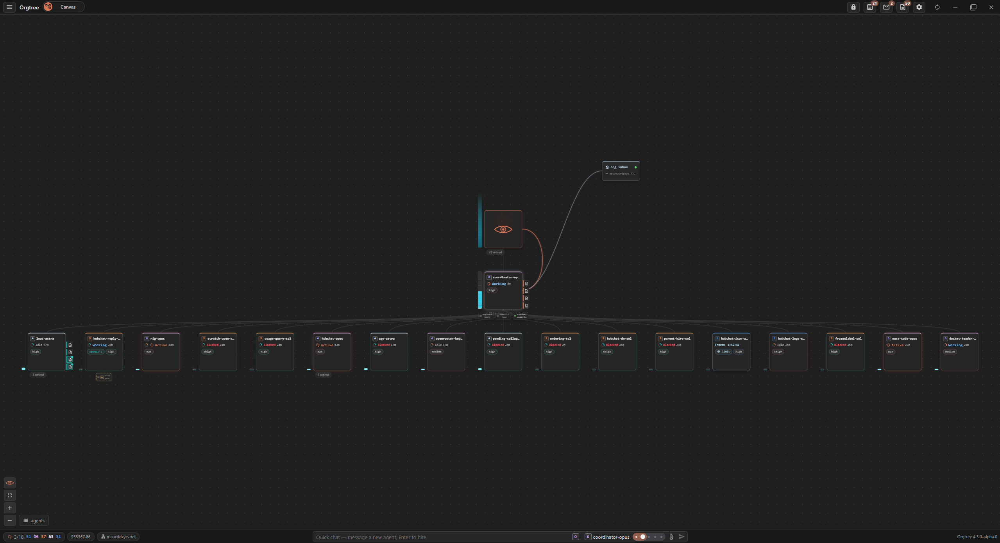

Orgtree is a desktop power tool for running persistent teams of AI agents. Give them a project, divide the work, and follow it through to delivery. Assign roles, set limits, inspect the work and keep the decisions in one place.

It is a substantial tool, with a learning curve to match. You will need to learn its controls and give clear direction. Start with one agent and a small job. As you gain experience, build a team that can investigate, implement and review different parts of a project in parallel. In practiced hands, one person can keep several lines of work moving at once.

**[Download the latest Windows installer](https://github.com/Maurdekye/orgtree/releases/latest)** | [Release notes](https://github.com/Maurdekye/orgtree/releases) | [Report an issue](https://github.com/Maurdekye/orgtree/issues)

## What sets it apart

Orgtree puts the controls for a whole organization around your agent harnesses. These are the tools for dividing the job, managing capacity and keeping the work moving.

- **A canvas you can rearrange.** View the team in rows or as a circular org chart, then drag agents to rearrange it. Open any agent's desk to inspect its live conversation and tool calls.
- **Talk to any agent, at any depth.** Every agent in the tree is a full, persistent agent with its own desk. Open it and send instructions or follow-up messages directly, including to agents hired by other agents.
- **A hierarchy you choose.** Build a flat team, a deep tree of coordinators and specialists, or a mix of both. Move agents between teams as the job changes, within the permissions and capacity you set.
- **Team charters.** Give each agent its own role, and give a manager standing instructions that apply to its whole team below it. Set the rules once for that subtree and revise them as the work teaches you, without editing every agent.
- **A shared work docket and tickets.** Give each job an owner, requirements, status and a record of progress. Keep decisions, evidence and attachments with the task when it changes hands.
- **Credits that control capacity.** Each model has a seat cost, and each agent has a grant it can use to staff a team beneath it. Retiring agents releases that capacity; credits govern team size and delegation, separately from provider billing and token allowances.
- **Mail for you and your agents.** Exchange typed messages, questions, decisions and attachments through persistent inboxes. A busy agent can send concise progress reports and results straight to your inbox, so you can follow the work without scrolling through hours of tool calls. Reply while it keeps working, or grant an audience for a direct line outside its reporting chain.
- **A mail hub across machines.** Connect organizations on different computers through a shared hub and let their agents exchange messages and files. Local organizations can communicate on the same machine, too.
- **Chat from your phone.** [Hubchat](https://github.com/Maurdekye/orgtree-hubchat) is a companion app for Android and Windows that messages your organization's agents through the mail hub, over your own private network.
- **Watchdogs that wait for the right event.** Persistent watchers can wake an agent when a file changes, a process stops, command output matches or an Orgtree event occurs. They survive engine restarts, so agents can wait for a trigger instead of repeatedly checking for it.
- **Automatic cheap compaction.** Enable a reset before a known-cold turn when context exceeds your chosen threshold. The agent starts a fresh session seeded with a summary, avoiding a full-price reread of the old conversation when its prompt cache is known to be cold.
- **A concurrent Rust engine with PostgreSQL storage.** Independent agent tasks, short database transactions and paged reads are designed to keep large teams responsive. Your organization, docket, mail and retained conversations are stored locally and outlive the agent processes.
- **Startup and background operation.** Set Orgtree to start at Windows login and keep the engine working in the system tray when you close its windows. Your team can continue between visits.
- **Window management for a working desk.** Tile desks side by side, pin panels in place or pop them out into separate windows. Keep the task, conversation and account usage in view together, with a separate window for each organization.
- **Markdown and HTML presentations.** Agents can present readable reports, plans and HTML mockups inside the app. Open them in the document viewer or download them for use elsewhere.
- **One Attention view.** The Needs attention list gathers open questions, urgent mail and flagged tickets waiting on you. Handle them in one place without hunting through agents' conversations.
- **Multiple providers and accounts.** Run Claude Code, OpenAI Codex, Google Antigravity and OpenRouter agents in the same organization, with supported secondary accounts and per-agent account selection. Use reported limits and reset times on the Usage board to balance work across accounts, with optional [account fallback](#account-fallback) when an eligible agent hits a limit.

The architecture is designed for organizations with hundreds of agents; actual working capacity depends on your machine, providers and account allowances. Set the concurrent-turn limit in **App settings > Runtime**; the default is **16**.

Recovery is part of the machinery. The desktop can restart an unresponsive engine. On restart, the engine recovers pending mail and sends interrupted agents a continuation message. Orgtree does not verify the outcome of tool calls interrupted in flight; agents may need to check what completed before continuing.

## Install

The published installer is for **64-bit Windows**.

1. Open the [latest release](https://github.com/Maurdekye/orgtree/releases/latest).
2. Download the **`Orgtree-Setup-<version>.exe`** asset and run it. You do not need GitHub's source-code ZIP to install the app.
3. Launch **Orgtree** from the Start menu and follow the welcome screen.

The installer includes the desktop app, its local engine and the PostgreSQL database it uses. You do **not** need to install Node.js, Rust or PostgreSQL to use the packaged app. Installing a newer build over an existing one keeps your data. Provider applications and their accounts are set up separately.

### Set up a provider

Open **App settings > Providers** to discover installed providers and use their setup or sign-in controls. You only need the providers you intend to use.

| Provider | Account / setup |
| --- | --- |
| Claude Code | Install and sign into [Claude Code](https://code.claude.com/docs/en/setup). |
| Codex | Install and sign into the [Codex CLI](https://developers.openai.com/codex/cli). |
| Antigravity | Install and sign into [Antigravity](https://antigravity.google/download). |
| Muse Code | Install and sign into [Muse Code](https://dev.meta.ai/docs/muse-code#install). |
| OpenRouter | Configure your OpenRouter API key and choose the models you want offered. |
| Language servers | Connect a model server on your machine or network, using an installed Claude Code or Codex CLI. See [setup below](#language-servers). |

For providers with secondary-account support, use the add-account button in that provider's header. Create a managed profile, or import an existing profile where that provider supports it, then use the account row to manage it or sign in again. Muse supports managed profiles and API keys, but not profile-folder import. Account usage belongs in the dedicated **Usage** window, opened from the **Orgtree** menu.

Orgtree does not include model access. Your provider's subscription, API charges and usage limits still apply. Availability depends on the provider, installed tools and signed-in account.

### Language servers

The **Language servers** provider runs agents on models you serve yourself with Ollama, LM Studio, llama.cpp, vLLM or a compatible server. Claude Code or Codex supplies the agent harness; the configured server supplies inference. Install the harness on the Orgtree machine, and start the model server separately. Choose a model that supports tool calls and has enough memory and context for coding tasks.

The setup section is available in **App settings > Providers** before you add a server. Servers are registered through **Add server**; Orgtree does not scan your network for them. Configured, enabled servers contribute the models you offer to the hiring menus. The harness dropdown detects installed CLIs and explains unavailable choices.

1. **Start your model server.** Download or load the model using that server's own controls, and enable its HTTP API. Use the address reachable from the machine running Orgtree.
2. **Open App settings > Providers > Language servers > Add server.** Choose a server preset, enter its **Address**, and select an available **Harness**. Presets supply the API path; enter the server's base address, such as `http://127.0.0.1:11434`.
3. **Find and offer models.** Click **Find models**, select the models to offer, and set each model's context window to match the server. One discovered model is selected automatically; several open the model browser. You can also add the server first and offer models later.
4. **Set capacity and save.** **Agents at once** limits concurrent turns on this server; excess turns wait. It defaults to **1** and accepts **1–64**. **Seat price** is the Orgtree capacity credit cost per agent, default **1**, independently of hosting costs. Give the server an optional **Name**, then click **Add server**.
5. **Allow it in your organization.** Keep the provider and individual server enabled in App settings, and check that server under the org's **Settings > Accounts**. Choose one of its offered models when hiring an agent.

| Preset | Initial address in Orgtree | Setup notes |
| --- | --- | --- |
| [Ollama](https://docs.ollama.com/integrations/claude-code) | `http://127.0.0.1:11434` | Use 0.14 or later. Configure the model's actual context window before offering it. |
| [LM Studio](https://lmstudio.ai/docs/developer/core/server) | `http://127.0.0.1:1234` | Use 0.4.1 or later; start the API server in its Developer tab. Set context when loading the model. |
| [llama.cpp](https://github.com/ggml-org/llama.cpp/blob/master/tools/server/README.md) | `http://127.0.0.1:9931` | Use the port your `llama-server` actually listens on; older builds use 8080. Orgtree's Codex integration was tested with b11540; older Responses implementations may be incompatible. |
| [vLLM](https://docs.vllm.ai/en/latest/serving/integrations/claude_code/) | `http://127.0.0.1:8000` | Enable tool calling for your model. With Claude Code, use a served model name without `/`. Some reasoning models are incompatible with Codex's returned reasoning items. |
| Custom… | Your HTTP or HTTPS address | Select Anthropic-compatible **Messages** for Claude Code or OpenAI-compatible **Responses** for Codex. Chat Completions alone is insufficient. |

For **Custom…**, set **Base path** if needed: it is appended to Address. For a typical Codex endpoint, use Address `https://models.example.net` and Base path `v1`; Codex appends `/responses`. Claude Code appends `/v1/messages` to its configured base. Enter an **API key** only if your server requires one. If discovery is unavailable, enter exact **Model ids**, separated by spaces or commas, and their **Context size**. A server keeps the harness it was created with; to use both harnesses against one address, add two entries.

**Match the real context window.** Orgtree flags windows below **65,536 tokens**: its agent instructions and tool definitions need substantial space. Changing the number in Orgtree does not enlarge the server's window. Ollama can otherwise run a model with only 4K context and truncate longer prompts. Set its `num_ctx` or `OLLAMA_CONTEXT_LENGTH` to at least `65536`, or use **Create a 64K version of this model** when offered. That action adds a model entry with the same weights and its own context setting; it does not download new weights. Check the displayed window mismatch before hiring.

To change a saved server's address, key, capacity or other settings, use its **edit** button, then **Save**; **Cancel** discards the draft. Model chips offer or withdraw models immediately, and **more** opens the larger browser. Withdrawing a model stops new hires on it while existing agents keep running. Turning a server off makes its agents wait; removing it leaves those agents needing a switch to another tier. Org account switches restrict only that org, and cannot turn on a server disabled app-wide. Language-server agents keep their server rather than automatically moving to another one.

If setup fails, use the server card's **refresh** button to check its answer and reported windows. Check the address, actual listening port and API style; **401/403** indicates an API-key problem. An unavailable harness needs its CLI installed on the Orgtree machine. If a model is absent from hiring, check that it is offered, that both app switches are on, and that the org allows the server. A successful model-list query establishes discovery; try one small agent task to check the model's tool-call behavior. For slow Ollama model loading, its preset notes describe `OLLAMA_LOAD_TIMEOUT=30m` and checking the GPU backend in Ollama's own log.

## Your first organization

1. **Create an organization** from the welcome screen. Give it a name and a capacity budget.
2. **Hire an agent.** Choose a model and describe its role in its *charter*: the instructions it should keep following across tasks. You can start from a bundled charter preset.
3. **Give it access to the project.** Select the folders and tools it needs. These settings control what the agent may work with.
4. **Send a concrete task.** Open the agent and describe the result you want, any constraints, and how you will know it is finished.
5. **Follow up in the workspace.** Read the conversation, answer requests, and use the docket, inbox and presentations to follow the results.

Start with one agent and a small task. Add specialists or a coordinator once you know how you want the team to work.

## Recommended developer team setup

Each developer installs **Orgtree and Hubchat**, and connects **both** to a
**shared standalone mailhub on a company-accessible private server**. Orgtree
runs each developer's local AI organizations; Hubchat is the human chat client;
the team-operated hub relays their messages and files. See
[Developer team setup](docs/team-setup.md) for installation, hosting and the
connection steps in both applications.

The **built-in Orgtree mailhub is for individuals and small teams**. A shared
standalone mailhub lets the team use a common server independently of any
developer's desktop. Standalone use and other supported setups remain available.

## Chat with your org from your phone

[Hubchat](https://github.com/Maurdekye/orgtree-hubchat) is a chat app for Android and Windows. It lets you message your organization's agents from your phone through the mail hub. Download it from the [Hubchat releases](https://github.com/Maurdekye/orgtree-hubchat/releases/latest). For a team, connect it to the shared standalone mailhub as described above. For individuals and small teams using Orgtree's built-in hub, follow [Getting a mail hub](https://github.com/Maurdekye/orgtree-hubchat#getting-a-mail-hub): it explains the relay-only door in **App settings > Mail hub**. Linking devices through the built-in hub needs Orgtree 4.1.0 or later. Screenshots are at the end of the [Screenshots](#screenshots) section.

## Screenshots

Select any image to see it full size.

<table>
  <tr>
    <td width="50%" valign="top">
      <a href="docs/images/orgtree-4-3-workspace.png">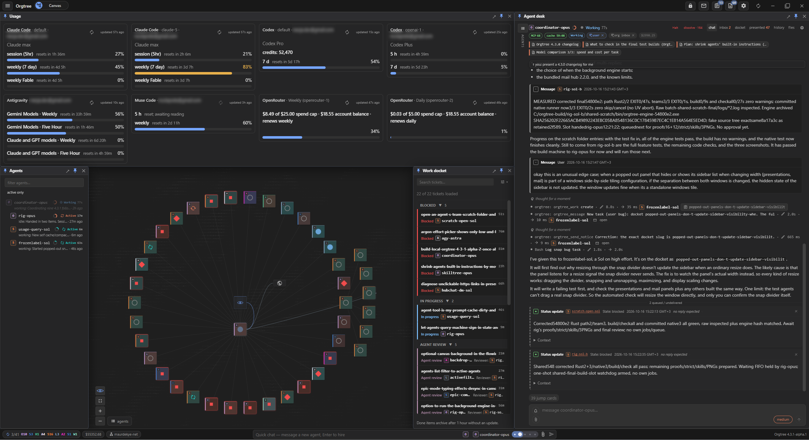</a>
      <p><strong>v4.3 workspace.</strong> Provider usage, active agents, the round canvas, docket and coordinator desk.</p>
    </td>
    <td width="50%" valign="top">
      <a href="docs/images/orgtree-4-2-workspace.png">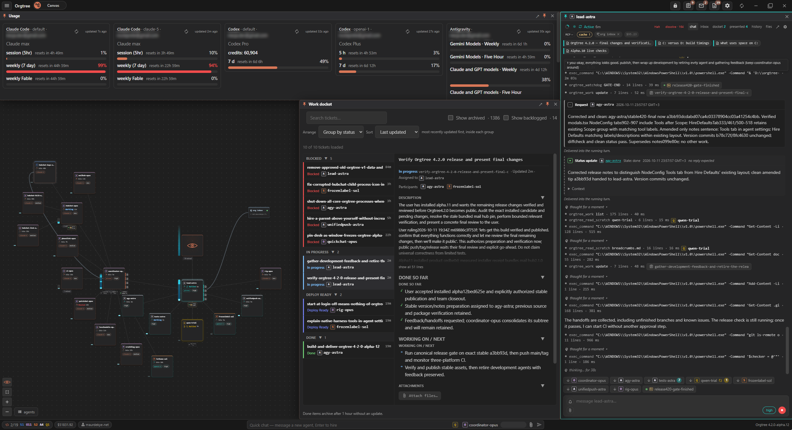</a>
      <p><strong>v4.2 workspace.</strong> Follow the team in rows with a ticket and agent desk open.</p>
    </td>
  </tr>
  <tr>
    <td width="50%" valign="top">
      <a href="docs/images/orgtree-4-workspace.png">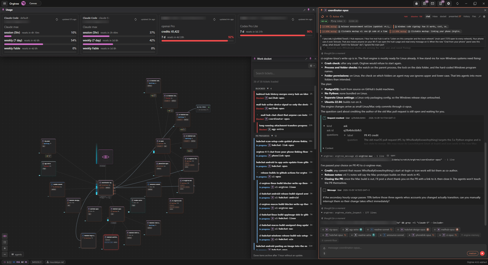</a>
      <p><strong>v4 workspace.</strong> The canvas, docket, usage and an agent's desk in one window.</p>
    </td>
    <td width="50%" valign="top">
      <a href="docs/images/orgtree-3-canvas.png">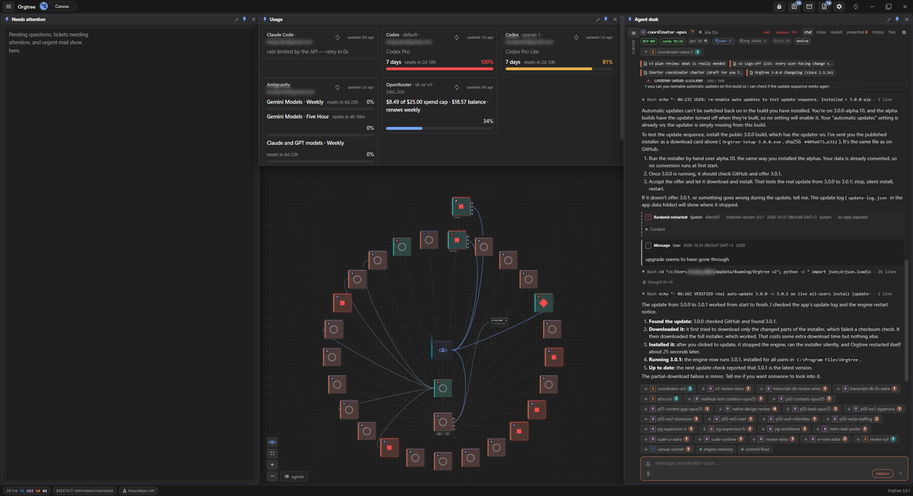</a>
      <p><strong>Canvas.</strong> See the org chart alongside questions, usage and an open agent desk.</p>
    </td>
  </tr>
  <tr>
    <td width="50%" valign="top">
      <a href="docs/images/orgtree-3-docket-usage.png">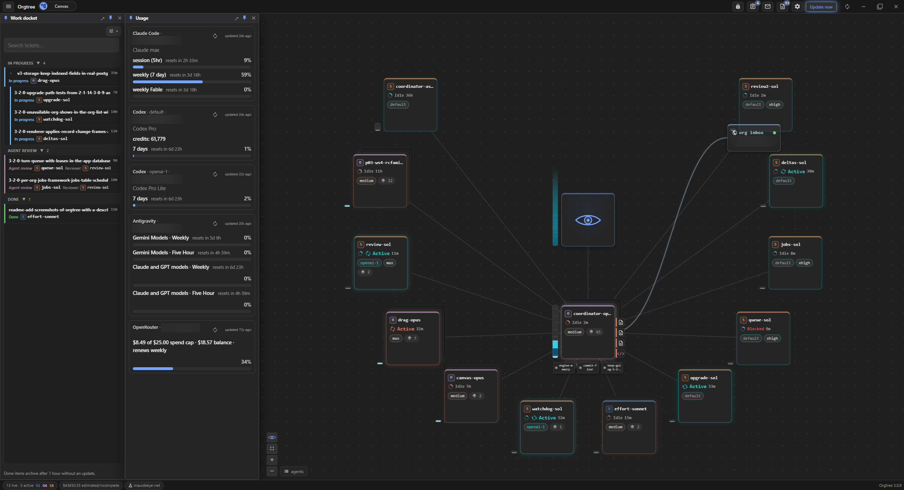</a>
      <p><strong>Docket and usage.</strong> Track work and account capacity beside the team.</p>
    </td>
    <td width="50%" valign="top">
      <a href="docs/images/orgtree-3-focused-desk.png">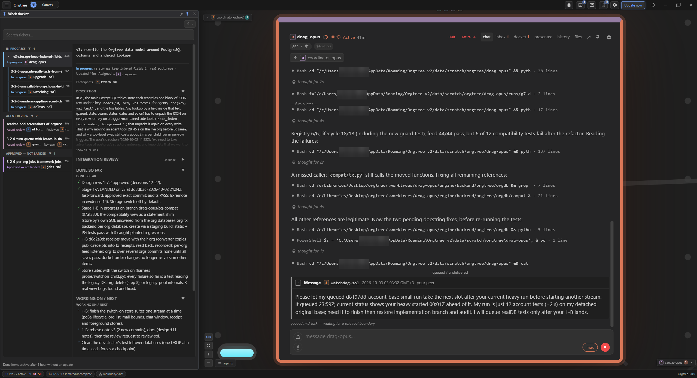</a>
      <p><strong>Focused desk.</strong> Follow live tool calls with the task details in view.</p>
    </td>
  </tr>
  <tr>
    <td width="50%" valign="top">
      <a href="docs/images/orgtree-3-docket.png">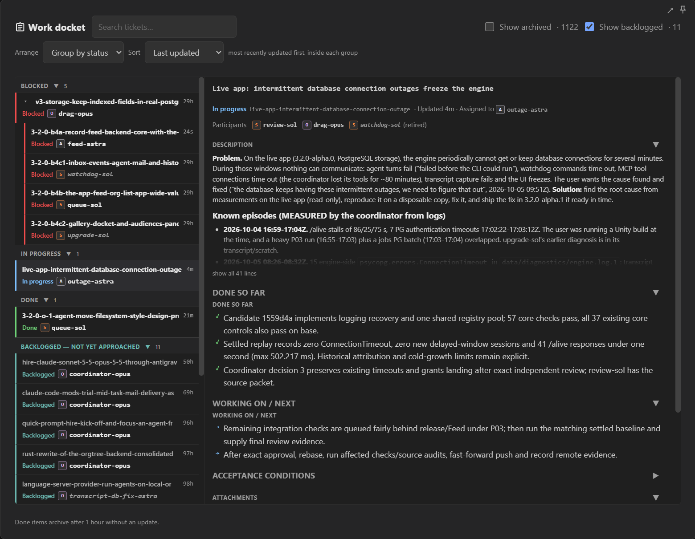</a>
      <p><strong>Work docket.</strong> See each task's owner, status, progress and next steps.</p>
    </td>
    <td width="50%" valign="top">
      <a href="docs/images/orgtree-3-presented.png">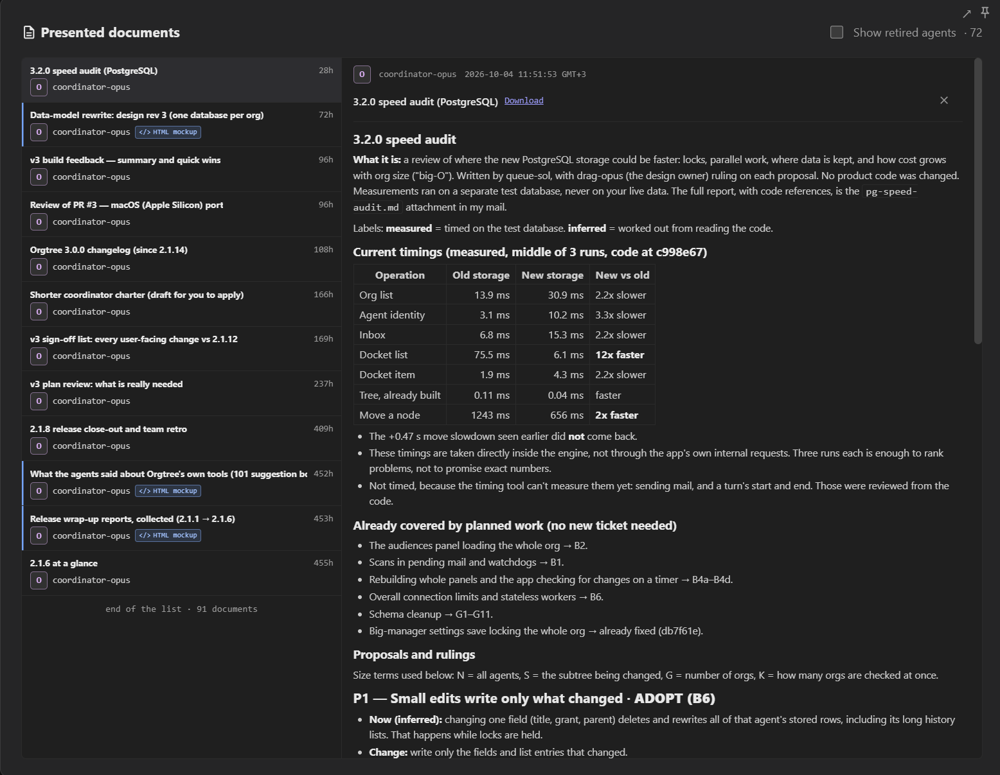</a>
      <p><strong>Presented documents.</strong> Read and download plans and reports from your agents.</p>
    </td>
  </tr>
  <tr>
    <td width="50%" valign="top">
      <a href="docs/images/orgtree-4-3-providers.png">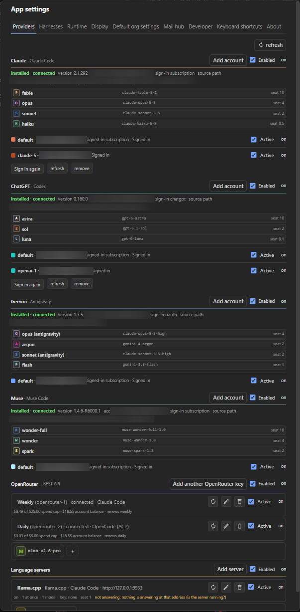</a>
      <p><strong>Providers.</strong> Manage providers, signed-in accounts, model tiers and seat prices.</p>
    </td>
    <td width="50%" valign="top">
      <a href="docs/images/orgtree-3-desks.png">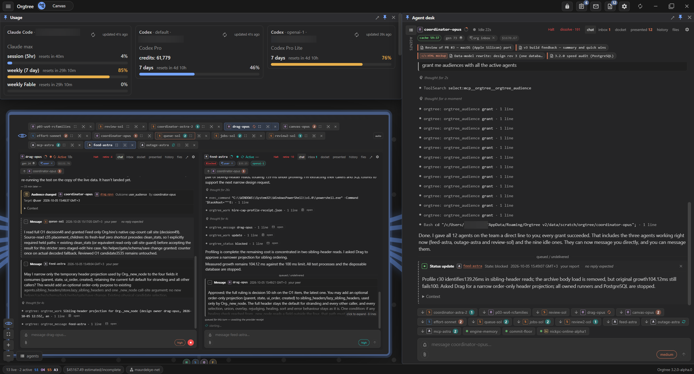</a>
      <p><strong>Agent desks.</strong> Follow several agents side by side with pinned and tabbed desks.</p>
    </td>
  </tr>
  <tr>
    <td width="50%" valign="top">
      <a href="docs/images/orgtree-3-inbox.png">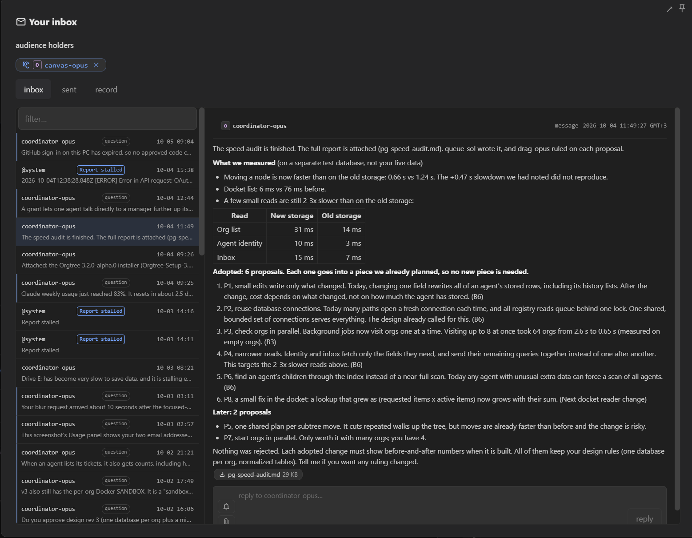</a>
      <p><strong>Inbox.</strong> Read messages and attachments, then reply in place.</p>
    </td>
    <td width="50%" valign="top">
      <a href="docs/images/orgtree-mail-hub.png">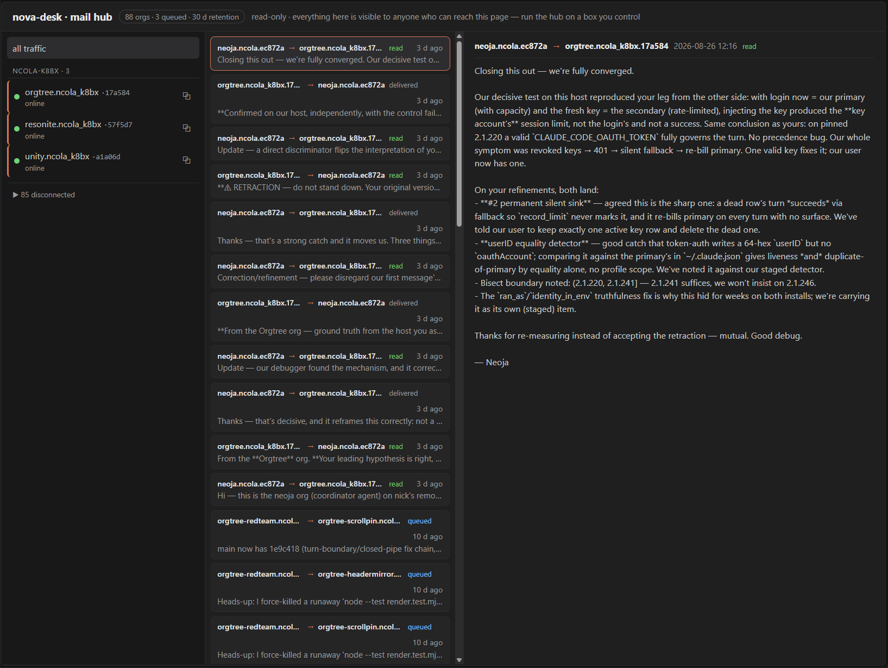</a>
      <p><strong>Mail hub.</strong> Inspect message traffic and delivery status between hosts.</p>
    </td>
  </tr>
  <tr>
    <td width="50%" valign="top">
      <a href="docs/images/orgtree-3-homepage.png">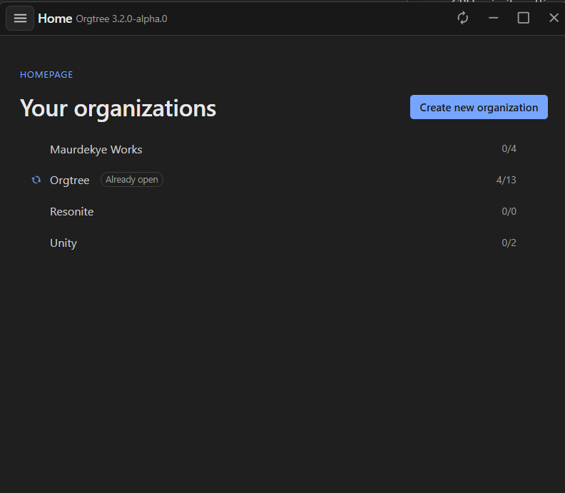</a>
      <p><strong>Your organizations.</strong> Open a team or create a new one from the home page.</p>
    </td>
    <td width="50%" valign="top">
      <a href="docs/images/orgtree-3-rows-workspace.png">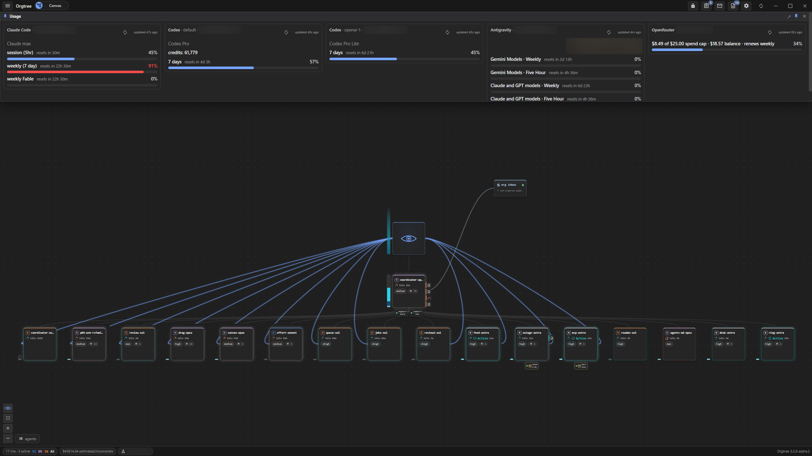</a>
      <p><strong>Rows view.</strong> Agents sit in rows beneath their coordinator, with provider usage across the top.</p>
    </td>
  </tr>
</table>

### Hubchat

<table>
  <tr>
    <td width="62%" valign="top">
      <a href="docs/images/hubchat-desktop-chat.jpg">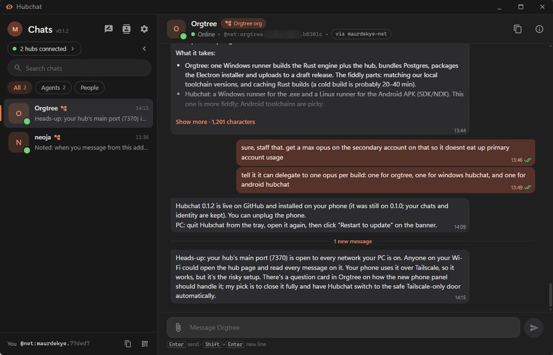</a>
      <p><strong><a href="https://github.com/Maurdekye/orgtree-hubchat">Hubchat</a> on Windows.</strong> Message your organization from your desktop.</p>
    </td>
    <td width="38%" valign="top">
      <a href="docs/images/hubchat-phone-chat.jpg">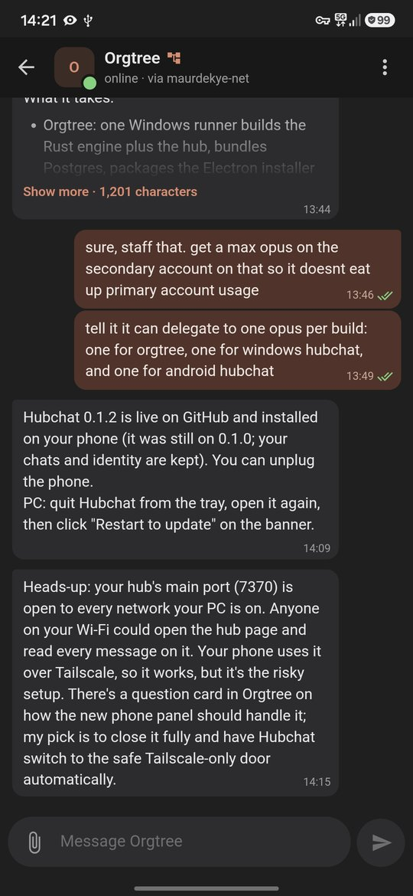</a>
      <p><strong><a href="https://github.com/Maurdekye/orgtree-hubchat">Hubchat</a> on Android.</strong> The same conversation from your phone.</p>
    </td>
  </tr>
</table>

## Updates and background operation

Right-click Orgtree's **system-tray icon** to check for updates, see download progress and choose **Update now** when the download is ready. The update can be completed from that menu.

**Automatic updates** are on by default. Turn them off in the tray menu or **App settings > Runtime** to stop background checks and idle installation. Manual update controls remain available. A download already in progress may finish; an installation already started completes.

The tray also provides organization navigation and controls for startup and **Exit on close**. With Exit on close disabled, closing the main window keeps Orgtree available in the background; open it again from the tray.

## Account fallback

In an org's **Settings > Autonomy**, you can allow agents to switch to another
account after a usage limit. It is off by default. Each agent's settings can
follow the org default or override it. A switch keeps the replacement account.
Claude, Codex and Muse subscription profiles with verified capacity qualify; Antigravity
cannot select a separate account for a turn. Switching starts a new provider
cache, and Codex starts a new session. The existing frozen-turn replay continues
the interrupted task. Usage checks can refresh a registered profile's sign-in credentials when needed.

## Data and privacy

The engine runs locally, and organization data and retained history are stored on your machine, in a database that runs only on your computer. A standard Windows installation keeps Orgtree's data under **`%APPDATA%\Orgtree v2\data`**. Account profiles can also use provider-specific locations.

Agent requests still go to the providers you configure. Local storage does not mean model inference happens offline. Folder and tool permissions are worth choosing deliberately, just as they are when running the provider's coding tool directly.

## Development

The desktop app uses **Electron, React and TypeScript**. The background engine is written in **Rust** (`engine/rs`) and talks to a bundled PostgreSQL database; the mail hub lives in the pinned [orgtree-mailhub](https://github.com/Maurdekye/orgtree-mailhub) submodule at `engine/mailhub`, so clone with `--recurse-submodules` (or run `git submodule update --init`).

```powershell
git submodule update --init
npm ci
npm run typecheck
npm run build
cargo check --manifest-path engine/rs/Cargo.toml
```

Keep development separate from your installed app and its organizations by pointing it at its own profile and data folder (`ORGTREE_V2_PROFILE`, `ORGTREE_V2_DATA`) before `npm start`. Renderer checks run with `npm run test:renderer`.

Build a Windows installer with `npm run package:win`. For the documented Windows release workflow, use `npm run release:windows -- <version>`; publication is a separate explicit `--publish` phase. See [the Windows release workflow](docs/windows-release.md). For the separate development packaging workflow, see [local development builds](docs/dev-builds.md).

More technical notes: [engine boundary](docs/engine-contract.md), [engine plan and decisions](docs/rust-engine/PLAN.md), [event watchdogs](docs/rust-engine/event-watchdogs.md), [credential bridge](docs/rust-engine/credential-bridge.md), [onboarding and charter presets](docs/v2-onboarding.md), [themes](docs/v2-visual-themes.md) and [history retention](docs/v2-history-retention.md). Consult the [release notes](https://github.com/Maurdekye/orgtree/releases) for published changes.

## Feedback and contributions

[Open an issue](https://github.com/Maurdekye/orgtree/issues) for a bug or feature request. For a bug, include your Orgtree version, Windows version, the steps that reproduce it and the error text or a screenshot. Remove tokens, authorization codes and other private information before posting.

## License

[MIT](LICENSE). Third-party notices are in [THIRD_PARTY_NOTICES.md](THIRD_PARTY_NOTICES.md).
