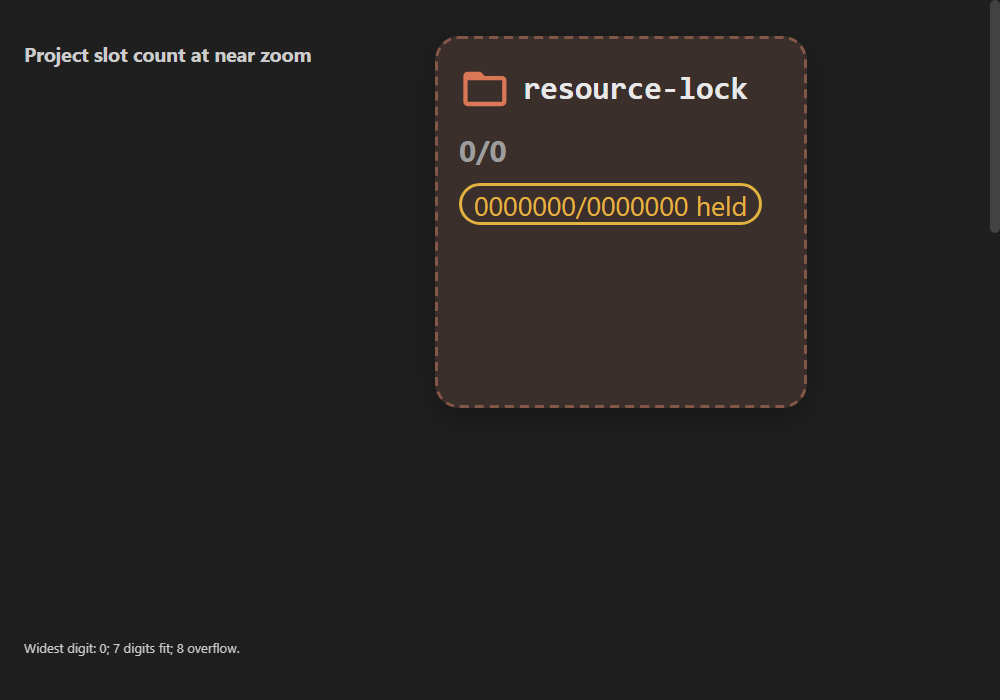

# Project slot capacity from the near-card count

User 2026-10-21 06:58–06:59Z requested the largest all-nines capacity whose
digit count fits the actual project card at near zoom, rather than a fixed
9999. The synthetic Chromium capture mounts the real ProjectSquare and its
unchanged stylesheet at 3x zoom, then tests the complete `held/total held`
badge with the widest digit. All ten digits have the same measured width.

| Measurement | Result |
| --- | --- |
| Card width | 124 CSS px (372 at 3x) |
| Available badge width | 108 CSS px |
| Font | 9px Segoe UI; 12px line height |
| Each digit | 4.8515625 CSS px |
| Seven-digit held/total badge | 101.1875 CSS px, one line |
| Eight-digit held/total badge | wraps to two lines |
| Selected maximum | 9,999,999 |

The existing CSS wraps long badge text rather than crossing the card edge;
the selected criterion keeps the full held/total badge on one line. Waiting
annotations may wrap independently. PostgreSQL integer, Rust i32 and JSON
numbers represent this maximum exactly. Migration 0049 relaxes the lease
constraint to the same value; engine and renderer constants and both tool
schema variants match it.

The capture uses synthetic data only. Its fixture and measurement live in
`apps/desktop/renderer/tests/slot-limit-{probe.tsx,after.cjs}`. The first
bundling attempt lacked font loaders; no measurement was taken until those
loaders were added. The capture shown uses zeroes because all digits tied
for widest; replacing them with nines has identical width.

Admission is independent of currently free units: it counts only the
requester's own active leases and pending reservations. Other holders cause
ordinary FIFO waiting. Multiple agent leases are allowed, but only one
armed/paused pending agent claim. The user retains multiple pending requests.
All requests and explicit resumes recheck while holding the project row lock.
Allocation yields only anchors needed by the grant batch and never builds a
capacity-sized vector. The UI renders 100 holder/waiter rows initially, with
explicit additional batches, and one holder chip/edge per agent/project.
